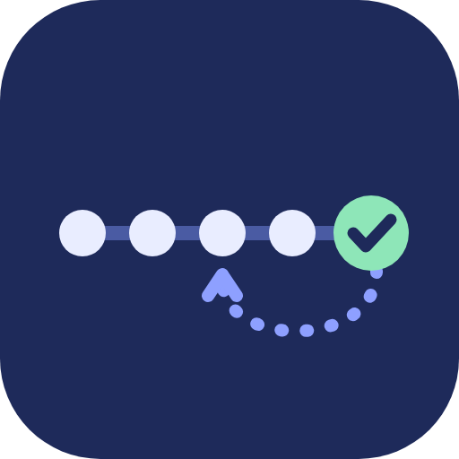
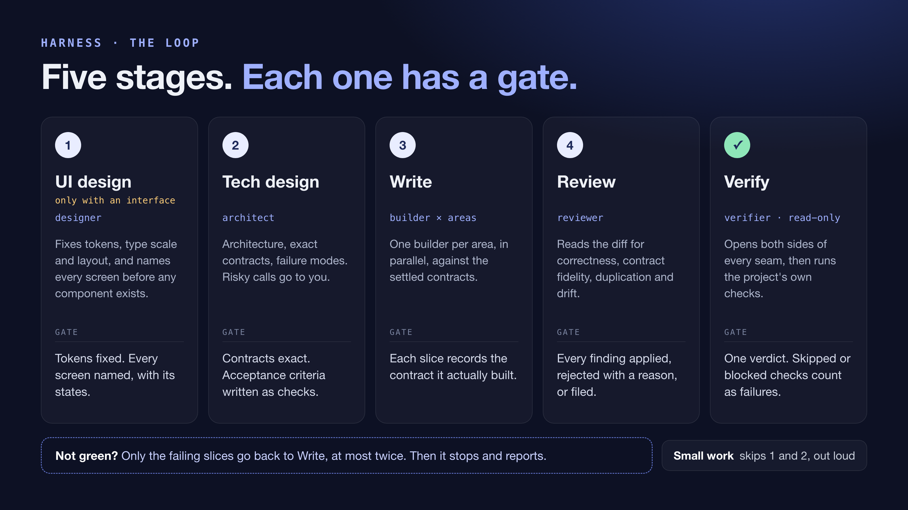
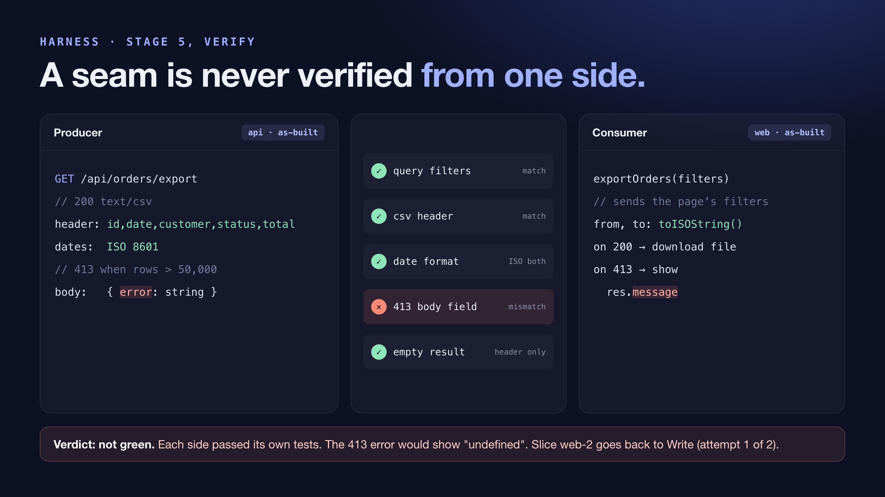
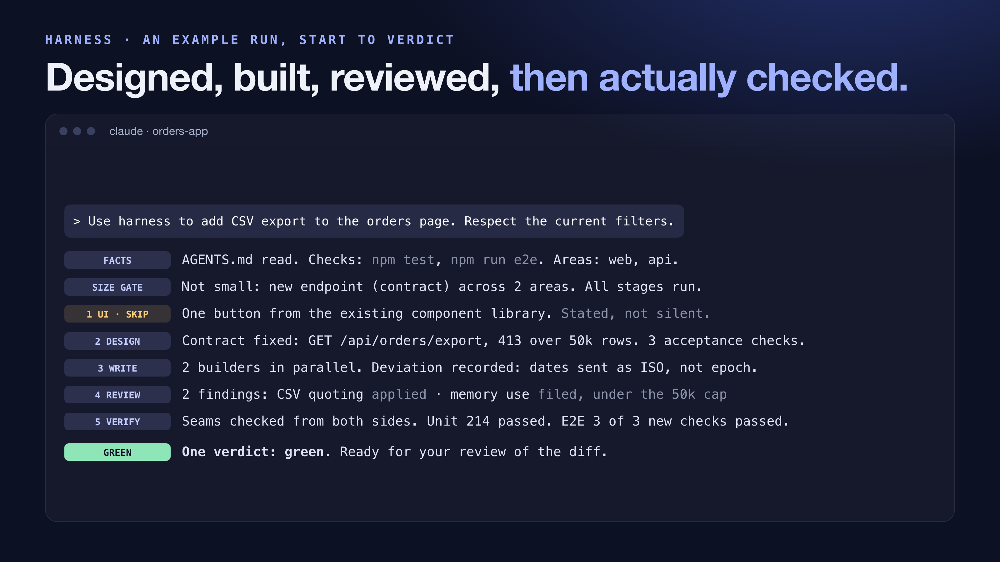

# Harness

A portable process for AI coding agents. Install it into a project and its agents already know how the work gets done: design before building, settle contracts before code, review the diff, and actually run the checks.

**The tool ships the process. The project holds the facts.** Harness is instructions only. It never reads, stores or sends your source. What it learns about a project goes into that project's own `AGENTS.md`.

## The loop

| # | Stage | Skill | Agent | Gate before moving on |
| --- | --- | --- | --- | --- |
| 1 | UI design (conditional) | `harness-ui-design` | `designer` | Tokens fixed, every screen named with its states. Skipped out loud when there is no interface |
| 2 | Technical design | `harness-tech-design` | `architect` | Contracts exact; acceptance criteria written as checks; irreversible, costly or user-visible calls escalated |
| 3 | Write | `harness-write` | `builder` (one per area, in parallel) | Each slice records the contract it actually built |
| 4 | Review | `harness-review` | `reviewer` | Every finding applied, rejected with a reason, or filed |
| 5 | Verify | `harness-verify` | `verifier` (read-only) | One verdict. Skipped and blocked checks count as failures |

If verify isn't green, only the failing slices go back to Write, at most twice. Small work (one area, no contract change) skips stages 1 and 2 and says so.

Verify is the stage that pays for itself. **A seam is never verified from one side**: the producer and the consumer are opened in the same pass, because two pieces can each pass their own tests and still disagree where they meet.







## Install into a project

```bash
npx @thinhledev/harness init
```

`init` reads the project's documents and manifests, never its source. It asks one question and shows everything else it worked out, with the file each fact came from:

| Input | How |
| --- | --- |
| checks | Assumed to be two tiers, unit and end-to-end. The commands are found in make and just targets, package scripts, language manifests and pipeline files. Recorded as `not yet established` when none is found |
| guardrails | **The one question.** Five defaults always apply; you add what's specific to this project |
| design system | Inferred from design documents, what the readme and docs point at, and token files. Otherwise `none` |
| areas | Inferred from workspace declarations, documented structure and top-level layout. Otherwise a single area |

Correct any fact in the confirmation pass, then it writes:

- `AGENTS.md`: a Harness section between `<!-- harness:begin -->` markers (loop, facts, guardrails). The rest of the file is left alone.
- **Claude Code:** a one-line `@AGENTS.md` bridge in `CLAUDE.md`, plus `.claude/skills/harness-*/SKILL.md` and `.claude/agents/*.md`.
- **Codex:** `.agents/skills/harness-*/SKILL.md` and `.codex/agents/*.toml`.

It writes for the agent tools the project already uses (it looks for `.claude/` and `CLAUDE.md`, or `.codex/` and `.agents/`). If it finds neither or both, it writes for both; `--agent claude|codex|all` overrides this. What carries over to Codex, and what doesn't, is in the [capability matrix](docs/capability-matrix.md).

Rerunning keeps recorded facts and guardrails, fills in facts that are still open, and flags any recorded fact the scan now reads differently. It never overwrites an agent or skill file it didn't write, unless you pass `--force`.

```
Options:
  --dir <path>   project to set up (default: current directory)
  --agent <id>   claude, codex or all (default: detected from the project)
  -y, --yes      accept what was worked out and ask nothing
  --force        replace agent and skill files that harness did not write
  --dry-run      show what would be written; change nothing
```

## Install as a Claude Code plugin

```
/plugin marketplace add thinhledev/harness
/plugin install harness@thinhledev
```

The plugin ships the skills and agents. Run `init` once per project so the agents have facts and guardrails to read.

## Install for Codex

There is no Codex plugin yet. Codex plugins can't bundle custom agents, so `init` is the complete install:

```bash
npx @thinhledev/harness init --agent codex
```

This writes the Harness section to `AGENTS.md`, the skills to `.agents/skills/`, and the agents to `.codex/agents/`. Without `--agent`, `init` sets up Codex on its own when the project already has `.codex/` or `.agents/`.


## Development

```bash
npm test
```

This runs the unit tests and `scripts/check-specifics.js`, the release rule: no skill or agent may name a framework, a service or a command. Anything that specific belongs in a project's `AGENTS.md`.

MIT licensed.
